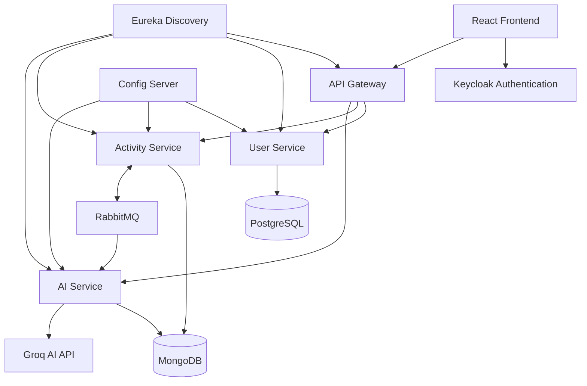

# FitPulse

### AI-Powered Fitness Tracking Platform

FitPulse is a full-stack fitness tracking application built with Java, Spring Boot Microservices, React, and AI integration.

It helps users track fitness activities, manage personal goals, generate workout plans, monitor workout adherence, and receive AI-powered fitness recommendations through an interactive AI Coach.

## Features

### 1. Fitness Activity Tracking
- Record and manage fitness activities.
- Track activity duration, calories burned, and additional metrics.
- View individual activity details.
- Receive AI-generated activity recommendations.

### 2. AI Fitness Coach
- Interactive AI fitness assistant powered by Groq.
- Context-aware responses based on activity history.
- Persistent chat conversations.
- Streaming AI responses.
- Edit and regenerate previous messages.
- Dynamic AI-generated follow-up suggestions.
- Markdown rendering for structured responses.

### 3. Fitness Goals
- Create, update, and manage fitness goals.
- Track goal progress.
- Generate AI-powered goal insights.
- Analyze activity history against fitness targets.

### 4. AI Workout Planner
- Generate personalized workout plans using AI.
- Review AI-generated workout recommendations.
- Save workout plans to your calendar.
- Track completed workouts.
- Monitor workout adherence and progress.

### 5. Authentication and Security
- Keycloak-based authentication.
- OAuth 2.0 and JWT validation.
- API Gateway security.
- User identity propagation through authenticated requests.
- User-level data ownership validation.
- BCrypt password hashing in the User Service.
- Protected API endpoints.

## Technology Stack

| Category | Technologies |
|---|---|
| Frontend | React, JavaScript, Material UI, CSS |
| Backend | Java 21, Spring Boot 3.4.3 |
| Microservices | Spring Cloud, Eureka, Spring Cloud Config |
| API Gateway | Spring Cloud Gateway |
| Authentication | Keycloak, OAuth 2.0, JWT |
| AI Integration | Groq API |
| Databases | MongoDB, PostgreSQL |
| Messaging | RabbitMQ |
| Build Tools | Maven, npm |
| Containerization | Docker, Docker Compose |
| Testing | JUnit 5, Mockito |
| Frontend Build | Vite |

## System Architecture

FitPulse follows a microservices architecture. Each service handles a specific business responsibility.

### Backend Services

| Service | Port | Responsibility |
|---|---:|---|
| Config Server | 8888 | Centralized configuration |
| Eureka Server | 8761 | Service discovery |
| API Gateway | 8080 | API routing and security |
| User Service | 8081 | User registration and profiles |
| Activity Service | 8082 | Activities, goals, and workout plans |
| AI Service | 8083 | AI recommendations, coaching, and workout generation |

### Infrastructure Services

| Service | Port | Responsibility |
|---|---:|---|
| PostgreSQL | 5432 | User data |
| MongoDB | 27017 | Activity and AI data |
| RabbitMQ | 5672 | Asynchronous messaging |
| RabbitMQ Management | 15672 | Message broker monitoring |
| Keycloak | 8181 | Identity and access management |

### Frontend

| Component | URL |
|---|---|
| React Application | http://localhost:5173 |

## Architecture Overview



## Project Structure

```text
fitness-app-microservices-main/
│
├── activityservice/
│   ├── src/main/
│   └── src/test/
│
├── aiservice/
│   ├── src/main/
│   └── src/test/
│
├── configserver/
│   └── src/main/
│
├── eureka/
│   └── src/main/
│
├── gateway/
│   ├── src/main/
│   └── src/test/
│
├── userservice/
│   ├── src/main/
│   └── src/test/
│
├── fitness-app-frontend/
│   ├── public/
│   ├── src/
│   ├── package.json
│   └── vite.config.js
│
├── docker-compose.yml
├── .env.example
├── .gitignore
└── README.md
```

## Prerequisites

Install the following before running the application:

- Java 21
- Node.js and npm
- Docker Desktop
- Git
- Maven, or use the included Maven Wrapper
- A Keycloak realm and client configuration
- A Groq API key

## Getting Started

### 1. Clone the Repository

```bash
git clone YOUR_GITHUB_REPOSITORY_URL
cd fitness-app-microservices-main
```

### 2. Configure Environment Variables

Create a `.env` file in the project root using `.env.example` as a reference.

Configure the following variables:

```env
POSTGRES_PASSWORD=your_database_password
DB_PASSWORD=your_database_password

KEYCLOAK_ADMIN_PASSWORD=your_keycloak_password

RABBITMQ_USERNAME=guest
RABBITMQ_PASSWORD=guest

GROQ_API_KEY=your_groq_api_key
GEMINI_API_KEY=your_gemini_api_key
GEMINI_API_URL=your_gemini_api_url
```

Never commit your actual `.env` file or API keys.

Make sure the required environment variables are also available to your Spring Boot services when running them outside Docker.

### 3. Start Infrastructure Services

From the project root:

```bash
docker compose up -d
```

Verify the containers:

```bash
docker compose ps
```

The infrastructure includes PostgreSQL, MongoDB, RabbitMQ, and Keycloak.

### 4. Configure Keycloak

Open:

http://localhost:8181

Then:

1. Log in using your configured administrator credentials.
2. Create a Keycloak realm.
3. Create and configure the frontend client.
4. Configure the appropriate redirect URIs.
5. Enable the required OAuth 2.0 authorization settings.
6. Update the frontend authentication configuration.

### 5. Start Backend Services

Start the services in this order:

1. Config Server
2. Eureka Server
3. User Service
4. Activity Service
5. AI Service
6. API Gateway

Use the Maven Wrapper from each service directory.

Windows:

```cmd
mvnw.cmd spring-boot:run
```

Linux/macOS:

```bash
./mvnw spring-boot:run
```

Verify Eureka:

http://localhost:8761

### 6. Start the Frontend

Open a new terminal:

```bash
cd fitness-app-frontend
npm install
npm run dev
```

Open:

http://localhost:5173

## Running Tests

Each backend service includes automated tests.

Navigate to the service directory and run:

Windows:

```cmd
mvnw.cmd clean test
```

Linux/macOS:

```bash
./mvnw clean test
```

The project uses JUnit 5 and Mockito for backend unit testing.

## Production Build

### Frontend

```bash
cd fitness-app-frontend
npm install
npm run build
```

Preview the production build:

```bash
npm run preview
```

### Backend

Run the following from each backend service directory:

```cmd
mvnw.cmd clean package
```

## API Access

The frontend communicates with backend services through the API Gateway.

Base URL:

```text
http://localhost:8080/api
```

The gateway handles API routing and JWT authentication before forwarding requests to the appropriate microservice.

## Future Improvements

- Deploy the application to AWS.
- Introduce centralized monitoring and distributed tracing.
- Add comprehensive integration and end-to-end tests.
- Implement CI/CD automation.
- Optimize frontend bundle size through code splitting.
- Add production-ready observability and logging.

## Author

Pritam Paul

Full Stack Developer | Java | Spring Boot | React | Microservices

GitHub: YOUR_GITHUB_PROFILE_URL

LinkedIn: YOUR_LINKEDIN_PROFILE_URL

---

Built with Java, Spring Boot, React, and AI integration.